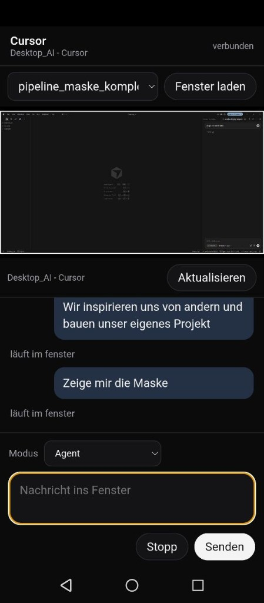
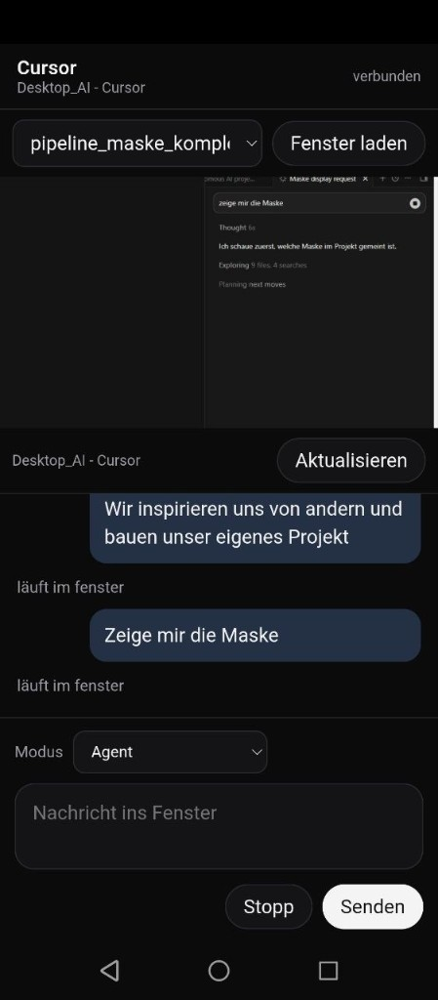
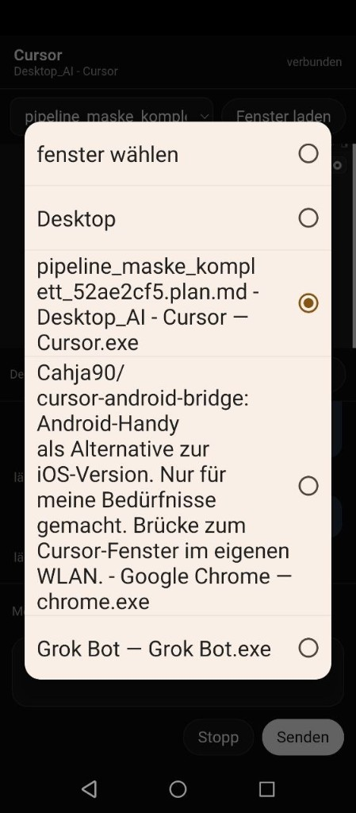

# Cursor Android Bridge

[](LICENSE)
[](https://www.python.org/downloads/)


A personal bridge from an Android phone to the Cursor agent on a Windows PC, in place of the iOS app.



## Features

- Dark chat page on the phone, plus a live picture of one desktop window you choose.
- Text you send is typed into that window on the PC and started there. The picture of the window stays on the phone.
- Two fingers zoom the window picture. One finger pans it. The chat under the picture keeps its size.
- The window list shows the open windows. One is selected, and the others stay in the list.
- Modes are Agent, Plan, and Ask.
- Each window has its own chat. Switching windows switches the history. A chat is removed after three days.
- When the agent wants to run something, Allow and Deny show up.
- The console prints the local address, the LAN address, and the Tailscale `100.x` address when Tailscale is running.

## Quick start

The bridge runs on Windows.

- Python 3.11 or newer, matching the current Pillow release
- Pillow and comtypes, from [requirements.txt](requirements.txt)
- The Cursor CLI (`agent`), signed in once on the PC
- The phone on the same Wi-Fi, with Chrome

Install the Python packages in this folder:

```powershell
py -3 -m pip install -r requirements.txt
```

If `agent` is missing:

```powershell
irm 'https://cursor.com/install?win32=true' | iex
```

Sign in once on the PC:

```powershell
agent login
```

After Windows sign-in, the task `handy_cursor` starts the watcher `watch_desk.py`. Once Cursor is running, the watcher starts the bridge. If port 8765 is already open, that running copy stays.

Start it by hand from this folder:

```powershell
py -3 desk_server.py
```

Point it at another project folder:

```powershell
py -3 desk_server.py --workspace D:\path\to\project
```

Keep the PC awake and keep Cursor running. The bridge then stays up on its own.

## Phone setup

1. On the home screen, tap the **Cursor** icon. The page opens without the browser bar.
2. Under the bar, pick a window. The picture keeps updating while that window is selected. Two fingers zoom the picture, and one finger moves it. The chat below keeps its size.
3. Write the message at the bottom. Choose Agent, Plan, or Ask (labeled Fragen on the page), then send. The text appears in that window on the PC.
4. Each window keeps its own chat. Changing the window changes the history. After three days, that chat is deleted.
5. When the agent wants to run something, use Allow or Deny.





The home-network address is printed in the console. The same page is also served over HTTPS on port 8766. Chrome installs a page as an app on a secure origin, where a service worker is allowed. The **Cursor** icon is a small fullscreen app that already trusts the bridge certificate and opens the page as an app. That icon is how you open the page the next time.

On the same Wi-Fi, other phones use the LAN address from the console. Keep the laptop on, with Cursor running. An address for use away from home stays in the private launcher configuration.

The Android project is in `launcher/`. Copy `launcher/desk_url.xml.example` to the gitignored `launcher/app/src/main/res/values/desk_url.xml` and put the address from the console there. Build it from `launcher/` with `gradlew.bat` (JDK 17). Leave the filled-in URL file, `.certs`, and tokens uncommitted.

## Security

Every request needs a token. The server writes it to `.desk_token`. Leave that file uncommitted, and keep the string private. The same string is in the address the console prints.

The token is accepted in three places:

- the address, as `?token=`
- the header `X-Desk-Token`
- the cookie `desk_token`, set when a valid address is opened

With no token, the page shows a short hint and the API returns an error.

The server listens on `0.0.0.0` port `8765` so the phone can reach it on the local network. Leave that port unpublished on the public internet. Chat and the window picture open only with the token.

Keep these out of git:

- `.desk_token`
- `.tunnel_token`
- `.certs`
- `chats.json`

## License

MIT. Forks, changes, and pull request reviews are welcome. The license text is in [LICENSE](LICENSE).

How to take part: [CONTRIBUTING.md](CONTRIBUTING.md).

Third-party works: [NOTICE.md](NOTICE.md).
